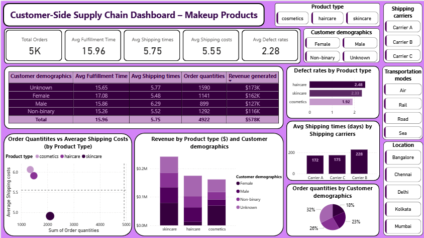

# Supply Chain Analytics Dashboard | Power BI

## 📌 Project Overview

This project focuses on analyzing Makeup Products Supply Chain Data using Microsoft Power BI. It includes two interactive dashboards that provide insights into supply chain performance from both **Supplier-Side** and **Customer-Side** perspectives.

The dashboards combine KPI cards, charts, filters, and data visualization techniques to help understand revenue, product sales, order fulfillment, shipping performance, manufacturing costs, and defect rates.

## 📊 Dashboard 1: Supplier-Side Analysis

### Key Insights

- Total revenue: **$578K** from **46K products sold**.
- Average supplier lead time: **17.08 days**.
- Compared manufacturing costs and production volumes across suppliers.
- Analyzed shipping costs across different transportation modes and carriers.
- Used scatter plots and quadrant analysis to explore the relationship between manufacturing costs and defect rates.

## 📊 Dashboard 2: Customer-Side Analysis

### Key Insights

- Total orders: **5K**.
- Average fulfillment time: **15.96 days**.
- Average defect rate: **2.28%**.
- Analyzed the relationship between order quantities and shipping costs across product types.
- Explored revenue distribution by product type and customer demographics.
- Compared shipping times across different shipping carriers.

## 🛠️ Skills & Techniques Applied

- Microsoft Power BI
- Data Visualization and Dashboard Design
- DAX (Data Analysis Expressions)
- KPI Cards and Calculated Measures
- Reference Lines and Trend Lines
- Conditional Formatting
- Scatter Plots and Quadrant Analysis
- Data Sorting and Formatting
- Interactive Filters and Slicers
- Display Units (K and M)

## 💡 Learning Outcomes

This project helped strengthen my understanding of Power BI dashboard development, data visualization, and business storytelling. It also highlighted how thoughtful visual design and meaningful KPIs can make complex supply chain information easier to understand and support business decision-making.

## 📁 Project Files

- `Supply-Chain-Analytics-Dashboard.pbix` – Power BI report file.
- `images/` – Screenshots of the supplier-side and customer-side dashboards.

## 👩‍💻 Author

**Ankita Kurade**

